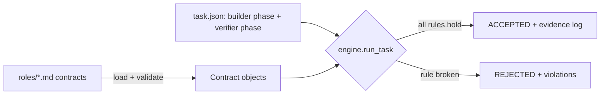

# agency-studio


[](https://github.com/mrodgersjs-web/agency-studio/actions/workflows/ci.yml)
[](LICENSE)
[](https://www.python.org/)

Agent role contracts written as markdown, with a validator and an engine that
enforces **Builder-Verifier separation**.

## Why this exists

Agent teams fail quietly when one role grades its own work or crosses into
someone else's files. This repo makes the boundary explicit: a contract says
what one role may read, write, run and do, and what evidence proves its work is
done. An engine then checks a real run against those contracts and rejects it
loudly when a rule is broken.

## Quickstart

```bash
pip install -e '.[dev]'
agency-studio validate roles                       # 6 contracts valid
agency-studio run examples/pass/task.json          # ACCEPTED, exit 0
agency-studio run examples/blocked-self-verify/task.json   # REJECTED, exit 1
pytest -q                                          # 56 tests
```

## Usage

A contract is markdown with front matter (`agency-studio schema` prints the
full schema as JSON, and [docs/contract-schema.md](docs/contract-schema.md)
documents it):

```markdown
---
name: verifier
kind: verifier            # scout|planner|builder|reviewer|verifier|documenter
purpose: Independently re-run the checks.
allow_read: [src/**, tests/**, evidence/**]
allow_write: []           # verifiers must be read-only
allow_tools: [python, pytest]
requires_evidence: [test_output]
---
Free-form markdown body.
```

A task names a builder phase and a verifier phase, each with a `role`, an
`agent` id and either an inline `report` or a `command` that prints a JSON
report. Real output from the bundled examples:

```text
$ agency-studio run examples/pass/task.json
ACCEPTED  Add greeting() and prove it works

$ agency-studio run examples/blocked-self-verify/task.json
REJECTED  Add greeting(); the builder tries to verify its own work
  [SELF_VERIFICATION] verifier: agent 'agent-alpha' verifies its own work
```

Exit codes for `run`: 0 accepted, 1 rejected, 2 bad input.

## How it works



The engine copies the task's workdir to a temp directory, runs the builder
phase, then the verifier phase, and checks each against its contract. Four
rules can reject a run:

| Rule | Fires when |
| --- | --- |
| `SELF_VERIFICATION` | The verifier is the builder's role or agent, or is forbidden from verifying it. |
| `BOUNDARY` | An action (declared or observed) is outside the role's allow-lists. |
| `EVIDENCE` | Required evidence is missing, ungrounded, fails its `sha256`, or is the builder's own reused. |
| `VERDICT` | The verdict is not `pass`, or `pass` contradicts its own executed checks. |

Verifier evidence must be grounded: a command the engine runs itself and must
exit 0, or a file whose `sha256` the engine recomputes. Bare text is never
accepted from a verifier.

## What it proves

Checks a reader can run:

1. `agency-studio validate roles` - all six bundled contracts satisfy the schema.
2. `pytest -q` - every rejection rule fires on a crafted input (see `tests/test_engine.py`).
3. `bash scripts/smoke.sh` - a sound run is accepted and a self-verification run is blocked.

## Project layout

```
src/agency_studio/   contract parsing + validation, enforcement engine, CLI
roles/               the six bundled role contracts
examples/            one sound task and one that must be blocked
tests/               unit tests for contracts, engine, CLI, schema
docs/                architecture, contract schema, public boundary
```

## Development

```bash
pip install -e '.[dev]'
ruff check src tests
pytest -q --cov=agency_studio
```

## Contributing

See [CONTRIBUTING.md](CONTRIBUTING.md). Small diffs with proof beat large
refactors; README claims must match runnable commands.

## Security

See [SECURITY.md](SECURITY.md). Report issues to security@rodgersintelligence.com,
not in a public issue.

## License

MIT. See [LICENSE](LICENSE).

Known limits: agent identity is the id the task declares; the engine compares
ids and cannot prove two ids are different models. File refs are
integrity-checked, not interpreted. Only workdir file changes are observed;
network and process side effects are not. The MCP wrapper in `mcp/` is separate
from the enforcement engine.

Built by Mike Rodgers · rodgersintelligence.com
